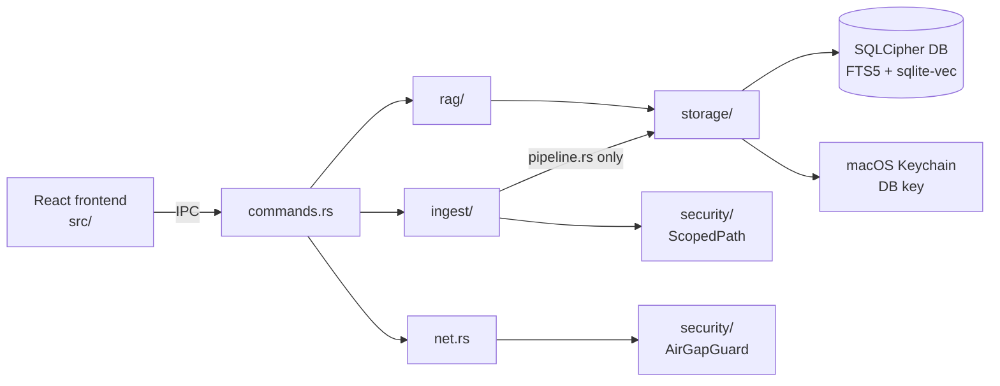
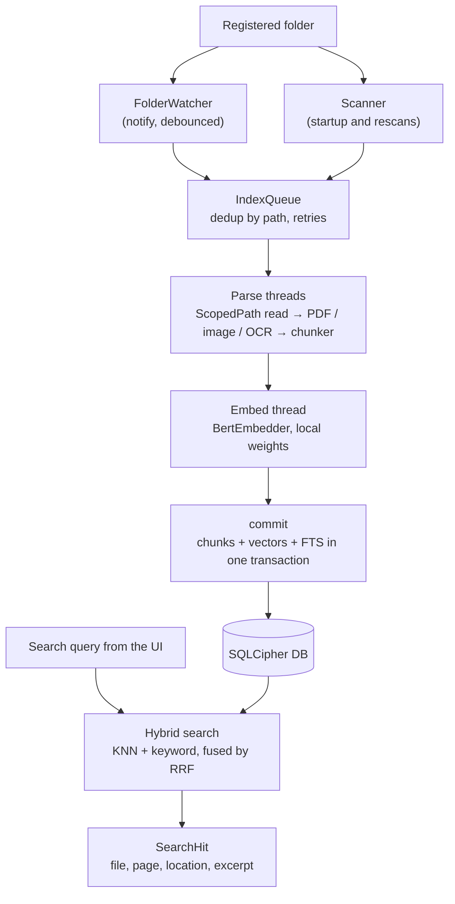
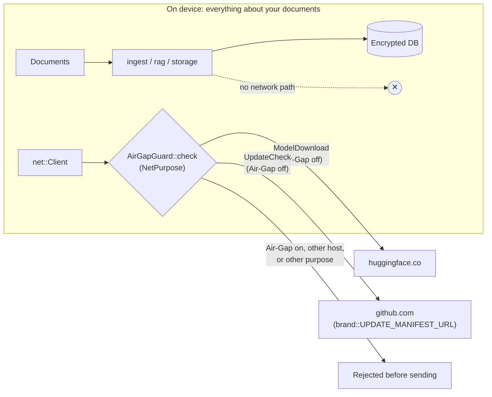

# Architecture

Locite is a Tauri v2 app. A Rust backend (`src-tauri/`) does all the work, and a React + TypeScript frontend (`src/`) talks to it only through IPC commands. This page shows how the modules fit together, how a document moves through them, and where the network boundary sits. The rules behind these boundaries are the absolute rules in [CLAUDE.md](../CLAUDE.md).

## Modules

| Module | Job | Must not |
| --- | --- | --- |
| `ingest/` | Turns a file into a `ParsedDocument` and then `Vec<Chunk>`. Holds the scanner, the folder watcher, the index queue and its scheduler, the PDF and image parsers, OCR, and the chunker. | Touch the DB, except `ingest/pipeline.rs`, which calls `Db` methods. All SQL stays in `storage/`. |
| `rag/` | Embeddings, the vector store, hybrid search (vector + keyword + RRF), and later answer synthesis and `.locitepack`. | Touch the file system. |
| `storage/` | The SQLCipher connection, migrations, FTS5, sqlite-vec, change history, and the keychain key. | Write anything outside the one encrypted DB. |
| `security/` | `AirGapGuard`, `ScopedPath`, and the PII guard. | Depend on any other app module. |
| `net.rs` | The only HTTP client. Every request passes `AirGapGuard::check(NetPurpose)` first. | Carry document content, chunks, embeddings, queries, or paths. |
| `commands.rs` | IPC entry points. Each one calls a service and converts its error to `AppError`. | Hold business logic. |
| `brand.rs` | Brand strings (name, bundle ID, keychain service, file extension, URLs). `build.rs` mirrors them into `src/brand.ts` and `tauri.conf.json`. | Be bypassed by hardcoded strings (`scripts/check-brand.sh` fails CI). |

Each module has its own `error.rs` (thiserror). Errors become `AppError { code, message }` only at the IPC boundary. IPC types are generated from Rust by ts-rs into `src/ipc/`.

## Data flow

Indexing runs on background threads, never on the async runtime.

1. The user picks a folder through the native picker. It is registered in the DB, and from then on `ScopedPath` allows reads only inside it, with no `..` and no symlink escapes.
2. The scanner and the watcher submit index jobs. The queue parses, chunks, embeds, and commits each file, at the pace the scheduler sets from search focus, power, idle time, and the user's schedule. A file that changed or vanished during indexing is requeued or removed.
3. Search embeds the query locally, runs KNN and keyword search, fuses them with RRF, and returns hits that each carry their source. Queries are never stored or logged.

## Network boundary

The app makes outbound requests for two purposes only, each starting at exactly one host. A model download may follow a redirect to a Hugging Face CDN host (`*.hf.co`), and an update check or update download to `release-assets.githubusercontent.com`; each hop passes the guard again. Updates run only on a click, and `update.rs` installs a package only after its minisign signature verifies against the key in `tauri.conf.json` (ADR-022). Air-Gap mode is on by default and blocks both. Sponsorship links open in the external browser, and the app itself sends no request for them.

- `NetPurpose` has two variants, and `NetPurpose::host()` maps each to the one host its requests start at. Hosts are compared exactly, so subdomains do not match. `net::Client::get` follows at most 3 redirects itself, and a ModelDownload redirect hop may reach a `*.hf.co` host (ADR-017), an UpdateCheck redirect hop exactly `release-assets.githubusercontent.com` (ADR-022).
- A response body stays in flight until it is read or dropped, so turning Air-Gap on stops a download mid-file.
- Turning Air-Gap on cancels in-flight requests, and the setting survives a relaunch. This is model-checked with TLA+ in `verification/airgap/`.
- There is no telemetry and no license or payment check, so nothing else needs the network.
